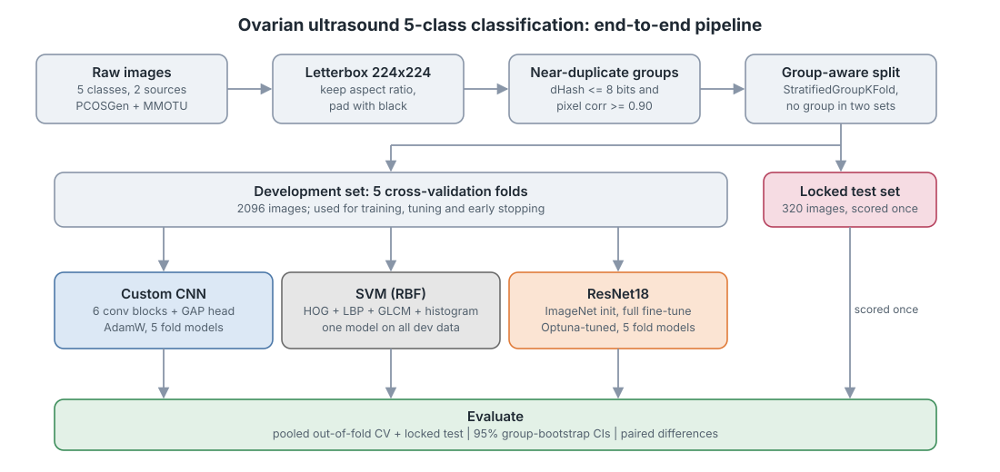
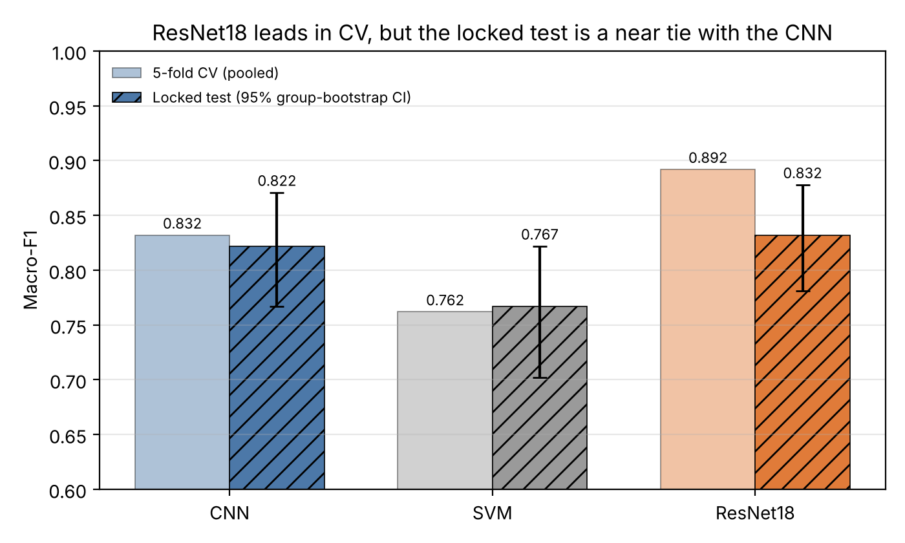
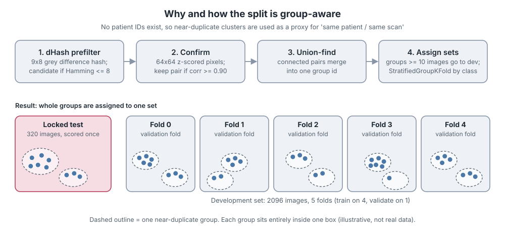
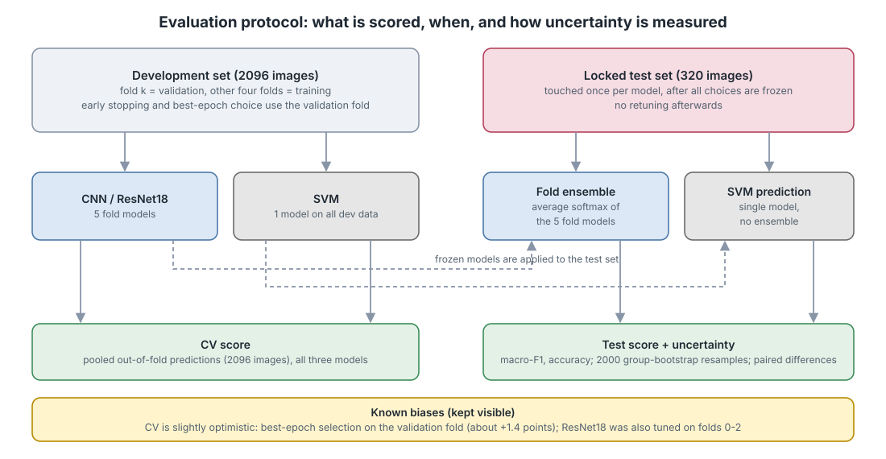
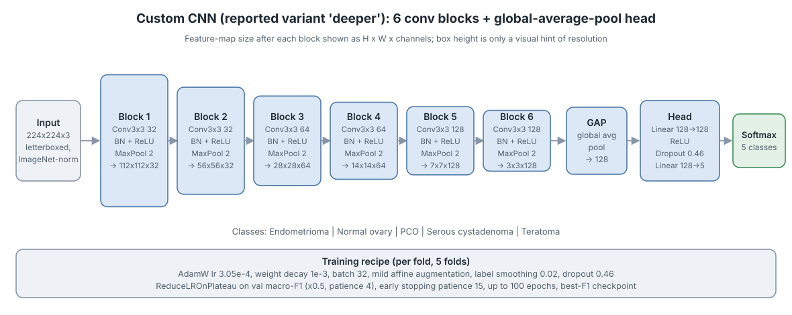
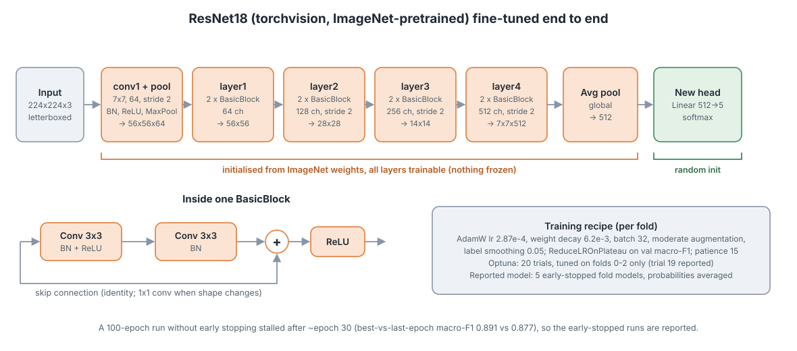
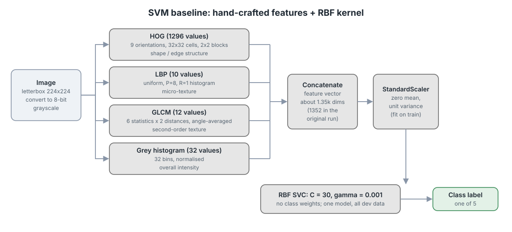

# Ovarian ultrasound classification: custom CNN vs SVM vs ResNet18

Five-class classification of ovarian ultrasound images (**Endometrioma, Normal ovary, PCO, Serous cystadenoma, Teratoma**) with three model families, evaluated with a leakage-aware protocol: near-duplicate images are grouped so that no group is split across training and test data.

> **Research code, not a medical device.** Nothing here has been validated for clinical use.



## Result in one table

Locked test set, 320 images, each model scored once. Confidence intervals come from 2000 group-bootstrap resamples.

| Model | Test macro-F1 (95% CI) | Test accuracy | 5-fold CV macro-F1 (pooled) |
|---|---|---|---|
| Custom CNN (5-model ensemble) | 0.822 (0.767 to 0.871) | 0.853 (273/320) | 0.832 |
| SVM (RBF, hand-crafted features) | 0.767 (0.702 to 0.822) | 0.816 (261/320) | 0.762 |
| ResNet18 (ImageNet init, 5-model ensemble) | **0.832** (0.781 to 0.878) | **0.859** (275/320) | **0.892** |



**What the numbers support, and what they do not**

- ResNet18 is better than the SVM on the locked test (paired macro-F1 difference +0.065, CI +0.013 to +0.119).
- ResNet18 and the CNN are **statistically indistinguishable on the test set** (+0.010, CI -0.039 to +0.060), even though cross-validation favoured ResNet18 by 0.060 (CI 0.041 to 0.079). The test set did not confirm the CV gap.
- CNN vs SVM is borderline (+0.055, CI -0.002 to +0.117).
- The expected ordering "ResNet18 > CNN > SVM" was **not forced**: only part of it is supported by the held-out data.
- All models are far better on PCO and Normal than on Teratoma and Serous cystadenoma ([per-class table](results/per_class_f1_locked_test.csv)).

Likely reasons for the CV-to-test gap (hypotheses, **not tested**): CV optimism that is larger for ResNet18 (tuned on folds 0 to 2, best-epoch selection on the validation fold, about +1.4 points), a small test set (about +/- 5 points), the CNN gaining more from ensembling than ResNet18, the mixture of image sources, and same-patient leakage that near-duplicate grouping cannot rule out.

Read the one-page summary: [`REPORT.md`](REPORT.md) (also as [`docs/report.pdf`](docs/report.pdf)).

## Why the evaluation looks the way it does



The images come from two public sources and contain many near-duplicates (probably the same scan or patient), and there are no patient IDs. A random split would leak and inflate every score. The split therefore clusters near-duplicates (dHash prefilter, then pixel correlation, then union-find) and assigns whole clusters to the locked test set or to one of five folds. This reduces, but cannot rule out, leakage.

Another caveat: the **PCO class comes only from one source and the three lesion classes only from the other**, so models can partly learn "which dataset" rather than anatomy. Test accuracy by source shows it: PCOSGen images 0.94 to 0.97, MMOTU images 0.71 to 0.77 ([table](results/accuracy_by_source_locked_test.csv)). The hard problem is telling the lesion types apart.



## The three models

| | Diagram | Key settings |
|---|---|---|
| Custom CNN | [03_cnn_architecture.svg](docs/diagrams/03_cnn_architecture.svg) | 6 conv blocks (32-32-64-64-128-128), BatchNorm, global average pooling, dropout 0.46; AdamW lr 3.05e-4, label smoothing 0.02, mild augmentation |
| SVM | [04_svm_pipeline.svg](docs/diagrams/04_svm_pipeline.svg) | HOG + LBP + GLCM + grey histogram, StandardScaler, RBF SVC (C=30, gamma=0.001) |
| ResNet18 | [05_resnet18_finetuning.svg](docs/diagrams/05_resnet18_finetuning.svg) | torchvision ImageNet weights, all layers fine-tuned; Optuna (20 trials, folds 0 to 2); lr 2.87e-4, wd 6.2e-3, label smoothing 0.05 |





Shared protocol for CNN and ResNet18: 5 group-aware folds, up to 100 epochs, early stopping (patience 15) on validation macro-F1, `ReduceLROnPlateau`; the test prediction is the average of the 5 fold models' softmax outputs.

## Repository layout

```
.
|- README.md, REPORT.md          overview and one-page report
|- src/ovarian/                  config, data, splits, models, features, train, evaluate
|- scripts/                      one command-line script per pipeline step
|- tests/smoke_test.py           end-to-end check on synthetic images (CPU, ~1-2 min)
|- results/                      small CSV tables + 2 figures (the numbers quoted above)
|- docs/diagrams/                6 editable SVG diagrams
|- docs/report.pdf               one-page report as PDF
```

## Quick start

```bash
python -m venv .venv && source .venv/bin/activate        # Windows: .venv\Scripts\activate
pip install -r requirements.txt
python tests/smoke_test.py                               # verifies the code path, no data needed
python scripts/make_figures.py --results results          # redraws the two result figures
```

Full pipeline (needs your own copy of the images, laid out as `data/images/<class_name>/*.png`; classes are `Endometrioma`, `Normal_ovary`, `PCO`, `Serous_cystadenoma`, `Teratoma`):

```bash
python scripts/make_splits.py --data-root data/images --out data/splits
python scripts/train_cv.py --model cnn      --splits data/splits --out runs/cnn
python scripts/train_svm.py                 --splits data/splits --out runs/svm
python scripts/tune_resnet.py               --splits data/splits --out runs/resnet_optuna   # optional, long
python scripts/train_cv.py --model resnet18 --splits data/splits --out runs/resnet18

# one-shot test scoring: run ONCE, after every choice is frozen
python scripts/train_cv.py --model cnn      --splits data/splits --out runs/cnn      --predict-test
python scripts/train_svm.py                 --splits data/splits --out runs/svm      --predict-test
python scripts/train_cv.py --model resnet18 --splits data/splits --out runs/resnet18 --predict-test
python scripts/evaluate_test.py --pred CNN=runs/cnn/test_predictions.csv \
    SVM=runs/svm/test_predictions.csv ResNet18=runs/resnet18/test_predictions.csv --out results_rerun
```

A GPU is strongly recommended for the CNN and ResNet18 steps. Training is resumable per fold.

## Honest reproducibility notes

- The numbers in `results/` were produced in the original Jupyter notebooks. The `src/` and `scripts/` files are a **clean refactor** of that work, so that nobody has to run the notebooks. They have passed a synthetic-data smoke test, but a full re-run on the real images has **not** been done, so expect small numerical differences.
- The SVM feature extractor is a re-implementation (1350 features here; the original run had 1352). Re-run the SVM before comparing its numbers.
- The Optuna search ranges in `scripts/tune_resnet.py` are reconstructed; the best trial that was actually used is stored in `src/ovarian/config.py`.
- Results use a single seed (42). CV scores are slightly optimistic (best-epoch selection on the validation fold).
- Open data issues: nine pairs of near-identical images carry conflicting labels and one pregnancy-like scan is labelled Normal; both were left unresolved.
- The full per-class precision / recall / F1 / support CSV is kept in the author's local `final results` folder; this repo includes the per-class F1 table and regenerates the full table with `scripts/evaluate_test.py`.

## What is deliberately not in this repository

Images (licences belong to the original dataset owners), trained weights (about 255 MB with all runs), Optuna databases, and training logs. This keeps the repository small (about 1 MB) and well inside GitHub's limits (files above 100 MB are rejected; keep repositories well under 1 GB). If you want to share weights, attach them to a GitHub Release or host them elsewhere and link them here.

## Data

Two public sources were merged; obtain them from their original publishers and follow their licences: PCOSGen (PCO class) and MMOTU (lesion classes). Citations for both: add before publishing.

## License

Code: MIT (see `LICENSE`). Data and model weights are not covered by this licence.
