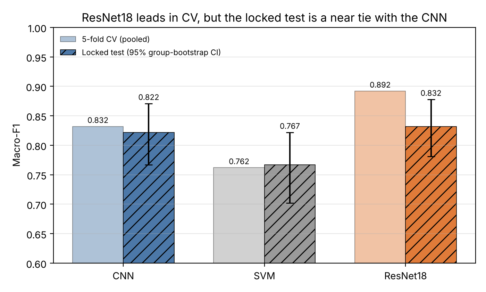
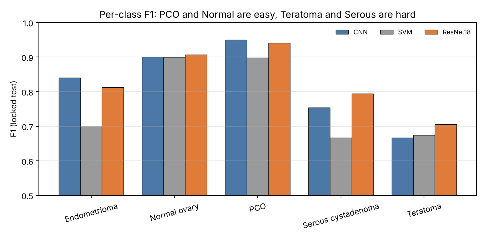

**Question.** On a merged ovarian ultrasound dataset (five classes: Endometrioma, Normal ovary, PCO, Serous cystadenoma, Teratoma), does a pretrained ResNet18 beat a custom CNN, and do both beat a classical SVM, when near-duplicate images are kept out of the test set?

**Data and split.** 2416 images from two public sources (PCOSGen, MMOTU). No patient IDs exist, so near-duplicates (dHash distance at most 8 bits, then pixel correlation of at least 0.90) were merged into groups by union-find. A locked test set (320 images) and five cross-validation folds (2096 development images) were built with `StratifiedGroupKFold`, so no group appears on both sides. Leakage is reduced, not excluded.

**Models.** *CNN*: six Conv-BN-ReLU-MaxPool blocks (32-32-64-64-128-128), global average pooling, dropout 0.46. *SVM*: RBF kernel (C = 30, gamma = 0.001) on standardised HOG, LBP, GLCM and grey-histogram features. *ResNet18*: ImageNet weights, all layers fine-tuned, hyper-parameters from a 20-trial Optuna search on folds 0 to 2. CNN and ResNet18 share one recipe (AdamW, label smoothing, early stopping on validation macro-F1); their test predictions average the five fold models. Each model was scored once on the locked test set, with 95% intervals from 2000 bootstrap resamples of groups.

| Model | Test macro-F1 (95% CI) | Test accuracy | CV macro-F1 (pooled) |
|:--|:--:|:--:|:--:|
| CNN | 0.822 (0.767 to 0.871) | 0.853 | 0.832 |
| SVM | 0.767 (0.702 to 0.822) | 0.816 | 0.762 |
| ResNet18 | 0.832 (0.781 to 0.878) | 0.859 | 0.892 |

{width=44%}
{width=44%}

**Findings.** (1) ResNet18 beat the SVM on the locked test (paired macro-F1 difference +0.065, 95% CI +0.013 to +0.119). (2) ResNet18 and the CNN are not distinguishable on the test (+0.010, CI -0.039 to +0.060), although cross-validation had favoured ResNet18 by +0.060 (CI +0.041 to +0.079). (3) CNN versus SVM is borderline (+0.055, CI -0.002 to +0.117). (4) All three models find PCO (test F1 0.90 to 0.95) and Normal (0.90 to 0.91) far easier than Teratoma (0.67 to 0.71) and Serous cystadenoma (0.67 to 0.79). (5) Accuracy is much higher on PCOSGen images (0.94 to 0.97) than on MMOTU images (0.71 to 0.77).

**Interpretation, with its limits.** The test set supports "ResNet18 above SVM" and "ResNet18 about equal to the CNN"; it does not support "ResNet18 above CNN". Possible reasons for the CV-to-test gap, none tested here: ResNet18-specific optimism in CV (tuned on folds 0 to 2; best-epoch selection adds about 1.4 points), a small test set (intervals span about 10 points), a larger ensembling gain for the CNN (single CNN fold models about 0.79 macro-F1 on the test versus 0.82 for the ensemble, while the ResNet18 ensemble gained nothing), the source mixture, and undetected same-patient leakage. Because PCO images come only from PCOSGen and the lesion classes only from MMOTU, class and image source are confounded, so part of the apparent skill may be dataset recognition. A 100-epoch ResNet18 run without early stopping stalled after about epoch 30 (best versus last epoch macro-F1 0.891 versus 0.877).

**Limitations.** One seed (42); one 320-image test set; no external validation; nine conflicting-label image pairs and one suspect scan left unresolved; no patient-level metadata; not a clinical evaluation. **Next steps** that would sharpen the conclusion: an MMOTU-only four-class comparison to remove the source confound, stricter patient-like grouping, repeated seeds, and a larger or external test set.

**Code and data.** Code, diagrams and result tables are in this repository (`README.md` explains how to run it); images and trained weights are not redistributed. Dataset citations and licences: to be added by the author before publication.
